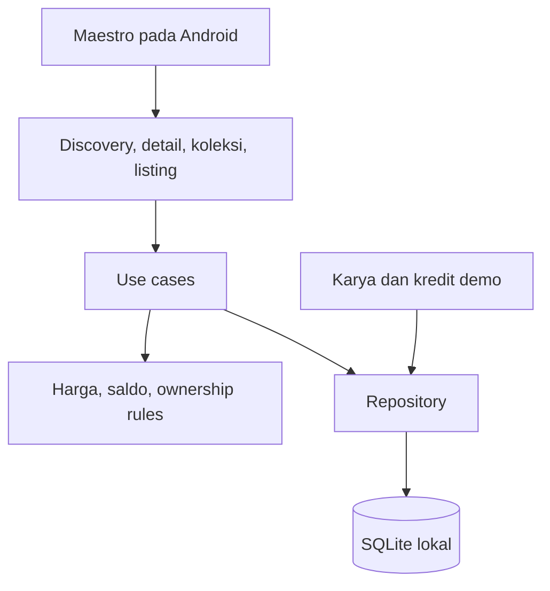

# Architecture — RavaCollect

Status: arsitektur implementasi awal. Repository/domain tersedia; layar saat ini dikelompokkan di src/app sebelum kebutuhan pemisahan fitur lebih lanjut.

## Batas sistem

Aplikasi React Native CLI dengan SQLite lokal serta aset bawaan. Semua kepemilikan, listing, dan kredit adalah data simulasi pada perangkat ini. Tidak ada koneksi wallet atau blockchain.

## Modul

- `discovery`: katalog, pencarian/filter/urutan, detail.
- `watchlist`: simpan/hapus favorit tanpa duplikasi.
- `credits`: saldo yang dihitung dari ledger dan riwayatnya.
- `purchase`: konfirmasi, validasi saldo, idempotensi, transaksi database.
- `collection`: ownership lokal dan detail karya milik sendiri.
- `listings`: CRUD, publish/unpublish lokal, validasi ownership.
- `activity`: riwayat event committed.
- `data`: schema, migrasi, fixture, repository; akses SQLite hanya di sini.
- `shared`: komponen, format kredit, aksesibilitas, feedback, dan testID.

## Pembelian atomik

Satu use case menerima artwork ID dan operation ID stabil. Dalam satu transaksi: periksa operation ID, baca harga, cek ownership/saldo, tulis purchase, debit ledger, ownership, dan activity; lalu commit. UI diperbarui sesudah commit. Kegagalan membatalkan seluruh perubahan. Replay operation ID yang sama mengembalikan hasil lama, bukan pembelian kedua.

Ledger menjadi sumber saldo; saldo turunan tidak ditulis sebagai angka terpisah yang dapat berbeda dari ledger. Ownership unik per karya. Seluruh operasi write diserialisasi agar dua pembelian tidak membaca saldo lama secara bersamaan.

## Listing dan riwayat

Listing hanya untuk karya yang dimiliki dan unik per artwork. Perubahan listing beserta activity ditulis atomik. Menghapus listing tidak menghapus ownership atau histori. Tidak ada service yang diam-diam menyimulasikan pembeli baru atau pendapatan.

## Pemulihan dan pengujian

Seed pada database baru saja; migrasi berurutan dan transaksional. Data invalid memunculkan error pemulihan tanpa silent reset. Reset demo memerlukan konfirmasi dan mengganti state secara atomik.

Integration test memakai SQLite asli untuk saldo, ownership, rollback, dan replay. E2E menguji UI di aplikasi terpasang, termasuk relaunch tanpa clear data. Fault injection tersedia hanya pada build E2E; release menggunakan repository yang sama tanpa kontrol fault.

Entry normal `index.js` tidak mengimpor `e2e/TestApp.tsx`. Build `e2e` memakai `index.e2e.js` dan app ID `com.ravacollect.e2e`; panel test menyuntikkan kegagalan SQL di dalam transaksi repository. Build normal memakai `com.ravacollect`. Entry dikunci per task bundle, termasuk pada command build gabungan. `:app:verifyBundleEntries` memeriksa mapping-nya. Manifest normal tidak meminta INTERNET; hanya debug menambahkannya untuk Metro.
